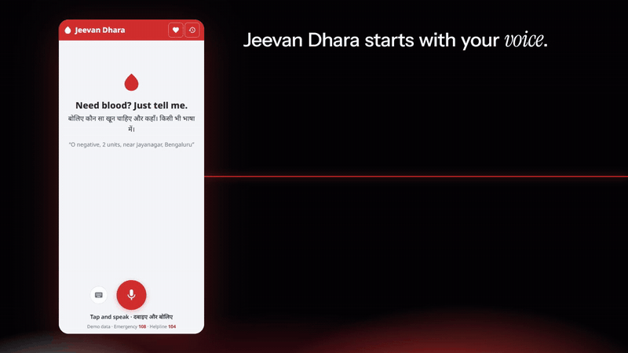
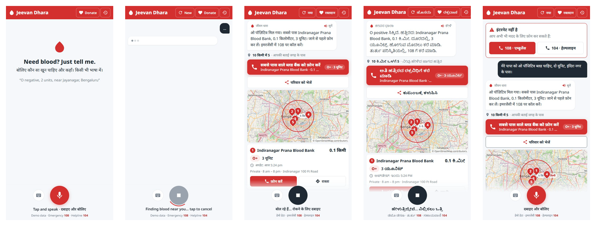
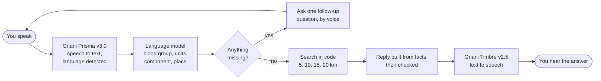

<div align="center">

# जीवन धारा · Jeevan Dhara

### Say what blood you need. Hear where to get it.

A voice-first blood finder for India. Tap once, speak in your own language,<br>
and it tells you the nearest blood banks that have what you need.

**[Try the live app](https://jeevan-dhara-itjf.onrender.com)** &nbsp;·&nbsp; **[One-page pitch](PITCH.md)** &nbsp;·&nbsp; **[Architecture](docs/ARCHITECTURE.md)**


<br>



</div>

<br>

> The live app runs on a free server that sleeps when idle. The first visit can take about a minute to wake it.
> All blood bank data is synthetic demo data.

## Contents

- [Why this exists](#why-this-exists)
- [What it does](#what-it-does)
- [See it](#see-it)
- [How it works](#how-it-works)
- [Tech stack](#tech-stack)
- [Run it yourself](#run-it-yourself)
- [Host it](#host-it)
- [Settings](#settings)
- [Tests](#tests)
- [Project layout](#project-layout)
- [Safety and privacy](#safety-and-privacy)
- [Known limits](#known-limits)
- [More documentation](#more-documentation)

## Why this exists

When someone you love needs blood at 2 AM, you are standing in a hospital corridor with a phone in a shaking hand.
Most blood finders ask you to pick a state, a district and a blood group from dropdowns, then solve a captcha, in English.
The people who need blood most urgently are often the least able to fill that form.

Jeevan Dhara removes the form. You say it the way you would say it to a person:

> "Mere papa ko O positive blood chahiye, do unit, Indiranagar ke paas."

A few seconds later it answers aloud, in your language, with the nearest blood banks and one big button to call the closest one.

## What it does

| | |
|---|---|
| **Speak or type, in 11 languages** | Hindi, Hinglish, English, Kannada, Tamil, Telugu, Malayalam, Marathi, Bengali, Gujarati and Punjabi. There is no language menu: it detects what you spoke, and the whole screen switches to it. |
| **Nearest banks first** | It looks within 5 km, then 10, 15 and 20 km, and shows distance, units in stock, opening hours, a call button and directions for each bank. |
| **Asks when something is missing** | If you leave out the blood group or the place, it asks one follow-up question by voice and keeps what you already said. |
| **Answers aloud** | The reply is spoken in the language you used, so you do not have to read anything. |
| **Share with family** | One tap writes a message with the bank names, phone numbers and a directions link, and hands it to WhatsApp or the phone's share sheet. |
| **Cancel any time** | Tap the big button while it is working. A request that takes over 25 seconds stops by itself. |
| **Works when the network does not** | With no internet, the screen still opens and puts **108** (ambulance) and **104** (health helpline) call buttons on top. |

## See it

<div align="center">

<br>
<sub>Start · Searching · Answer in Hindi · The same request in Kannada · No internet</sub>
</div>

## How it works



1. **Listen.** The browser records your voice. The server converts it with ffmpeg and sends it to **Gnani Prisma v3.0**, which returns the text and the detected language.
2. **Understand.** A language model fills a strict form: blood group, units, component and place. It can only choose from fixed values, so a spoken sentence cannot make it do anything else.
3. **Ask, if needed.** If the blood group or place is missing, the app asks one question and merges your answer with what you said before.
4. **Search.** Plain, tested Python finds matching stock near you, including compatible blood groups, widening the radius step by step. No model is involved in the search.
5. **Answer.** The facts of the reply (names, distances, units, phone numbers) are built by code. The wording is checked against those facts before **Gnani Timbre v2.5** speaks it.

### How fast it is

Measured on one request to the hosted build (free plan, one small shared CPU):

| Step | Time |
|---|---|
| Speech to text (Gnani Prisma) | 366 ms |
| Understanding the request | 299 ms |
| Searching blood banks | 0.5 ms |
| Audio conversion on the server | 1,798 ms |
| **Total, request to answer** | **2,467 ms** |

Audio conversion is the slow step on the free server; it is much faster on a normal machine.

## Tech stack

| Layer | Choice |
|---|---|
| Speech to text | **Gnani Prisma v3.0**, automatic language detection |
| Text to speech | **Gnani Timbre v2.5**, one voice per language |
| Understanding | A language model hosted on Groq, limited to a strict schema, with a fallback model |
| Server | Python 3.12, FastAPI, Uvicorn |
| Data | SQLite, seeded with synthetic blood banks, stock and donors |
| Audio | ffmpeg |
| Frontend | Plain HTML, CSS and JavaScript. No build step, so it loads fast on low-end phones |
| Packaging and hosting | Docker, Render |

## Run it yourself

You need API keys for [Gnani](https://app.gnani.ai/voice) and [Groq](https://console.groq.com). Without keys the app still runs: typed requests work and voice is off.

### With Docker (any OS)

```bash
cp .env.example .env        # then add GNANI_API_KEY and GROQ_API_KEY
docker compose up --build -d
```

Open http://localhost:8000. Stop it with `docker compose down`.

```bash
docker compose ps                                           # shows "healthy" when ready
docker compose exec jeevan-dhara python -m app.check_keys   # checks the keys without printing them
```

### Without Docker (Windows)

Needs Python 3.12 and `ffmpeg` on your PATH.

```powershell
python -m venv .venv
.venv\Scripts\python -m pip install -r requirements-dev.txt
copy .env.example .env      # then add GNANI_API_KEY and GROQ_API_KEY
.venv\Scripts\python -m uvicorn app.main:app --port 8000
```

Open http://127.0.0.1:8000, tap the mic and speak. Donor registration and request history are at `/app.html`.

## Host it

Phones allow the microphone only over HTTPS, so a public copy needs HTTPS in front of it.

**Render (simplest).** This repo includes [`render.yaml`](render.yaml). In Render, create a new web service from the repo, choose Docker, and add `GNANI_API_KEY` and `GROQ_API_KEY`. Render provides HTTPS and the public address.

**Your own server.** [`docker-compose.prod.yml`](docker-compose.prod.yml) adds [Caddy](https://caddyserver.com), which gets and renews the HTTPS certificate by itself. Point your domain at the server, set `DOMAIN=your.domain` in `.env`, then:

```bash
docker compose -f docker-compose.yml -f docker-compose.prod.yml up -d --build
```

Run one copy of the app only: the request limits and conversations in progress live in its memory.

## Settings

All settings are read from `.env` (or the host's environment). Keys never go into the Docker image or into git.

| Setting | Needed | What it is |
|---|---|---|
| `GNANI_API_KEY` | For voice | Gnani key for Prisma and Timbre |
| `GROQ_API_KEY` | For understanding speech | Groq key for the language model |
| `SECRET_KEY` | For a public copy | Signs sessions. `python -m app.keys` prints a new one |
| `PUBLIC_BASE_URL` | For a public copy | The `https://` address of the app. Turns on secure cookies |
| `DEMO_MODE` | Optional | `true` marks every screen as demo data |
| `REQUIRE_LOGIN` | Optional | `true` asks for a phone OTP before use |
| `WHATSAPP_ENABLED` and `TWILIO_*` | Optional | Turns on the WhatsApp voice-note channel, which is built but off by default |

See [`.env.example`](.env.example) for the full list.

## Tests

```powershell
.venv\Scripts\python -m pytest -q
```

89 tests cover the search (radius steps, blood compatibility, place lookup) and the API (requests, follow-ups, limits, security headers). They run without any API key.

## Project layout

```
app/
  main.py        Web endpoints, WhatsApp webhook, security headers
  pipeline.py    The request flow: merge, ask, search, reply
  gnani.py       Gnani Prisma (speech to text) and Timbre (text to speech)
  llm.py         Strict-schema extraction and translation of fixed replies
  search.py      Radius search, blood compatibility, place lookup
  replies.py     Reply text built from facts
  security.py    Hashing, signing, rate limits, audit log
  audio.py       ffmpeg helpers
  db.py, seed.py SQLite storage and the synthetic data
web/             The app: HTML, CSS, JavaScript, translations, offline support
tests/           89 automated tests
docs/            Architecture, product, security and design documents
Dockerfile, docker-compose.yml, docker-compose.prod.yml, render.yaml
```

## Safety and privacy

- **The voice does not invent facts.** Bank names, distances, units and phone numbers come from code and are checked before they are spoken.
- **Speech cannot hijack it.** The language model only fills a fixed form. It does not write free replies or run commands.
- **It always points to real help.** Every answer with results ends with the 108 emergency number, and every screen keeps 108 and 104 in view.
- **Limits protect the service.** Per-person, per-address and daily request caps, a 2 MB and 30-second limit on audio, and a timeout on every conversion.
- **Little is kept.** Phone numbers are stored as hashes, locations are rounded, and reply audio is deleted after 10 minutes.
- **Keys stay on the server.** They are read from the environment at start, never sent to the browser, and never committed.

The full threat model is in [docs/SECURITY.md](docs/SECURITY.md).

## Known limits

- **The data is synthetic.** Blood banks, stock and phone numbers are made up for the demo. Phone numbers start with `+91 00000` and cannot reach anyone.
- **Very short answers can be misheard.** A two-word reply such as "O positive" is sometimes transcribed wrongly. A full sentence works reliably.
- **Hinglish is answered in Hindi.** Speech to text writes Hinglish in Devanagari, so the app treats it as Hindi and replies in its Hindi voice.
- **The free server is slow to wake** and has no saved disk, so the demo data is rebuilt on every start.
- **WhatsApp is built but off.** It needs a Twilio account and a public address to run, so the demo leaves it switched off.

## More documentation

| Document | What is in it |
|---|---|
| [PITCH.md](PITCH.md) | The one-page pitch |
| [docs/ARCHITECTURE.md](docs/ARCHITECTURE.md) | Components, the voice pipeline, data model |
| [docs/PRD.md](docs/PRD.md) | Who it is for and what it must do |
| [docs/SECURITY.md](docs/SECURITY.md) | Threat model and controls |
| [docs/DESIGN.md](docs/DESIGN.md) | Visual and interaction design |

---

<div align="center">

Built by **Roushan Sharma** for the Great Indian AI Internship Challenge by Gnani.ai.

</div>
